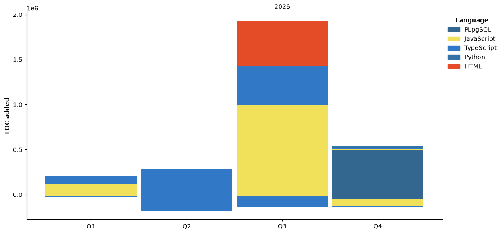

## Hi there 👋 I'm Victor Hugo!

🌐 NOC by day, builder by night. Networking, Python, TypeScript, Supabase — always shipping something small.

## Stack


## ⏱️ Coding Activity
<!--START_SECTION:waka-->


**🐱 My GitHub Data** 

> 📦 47.8 kB Used in GitHub's Storage 
 > 
> 🏆 929 Contributions in the Year 2026
 > 
> 💼 Opted to Hire
 > 
> 📜 3 Public Repositories 
 > 
> 🔑 11 Private Repositories 
 > 
**I'm an Early 🐤** 

```text
🌞 Morning                417 commits         ██████░░░░░░░░░░░░░░░░░░░   25.06 % 
🌆 Daytime                581 commits         █████████░░░░░░░░░░░░░░░░   34.92 % 
🌃 Evening                562 commits         ████████░░░░░░░░░░░░░░░░░   33.77 % 
🌙 Night                  104 commits         ██░░░░░░░░░░░░░░░░░░░░░░░   06.25 % 
```
📅 **I'm Most Productive on Wednesday** 

```text
Monday                   313 commits         █████░░░░░░░░░░░░░░░░░░░░   18.81 % 
Tuesday                  280 commits         ████░░░░░░░░░░░░░░░░░░░░░   16.83 % 
Wednesday                337 commits         █████░░░░░░░░░░░░░░░░░░░░   20.25 % 
Thursday                 249 commits         ████░░░░░░░░░░░░░░░░░░░░░   14.96 % 
Friday                   191 commits         ███░░░░░░░░░░░░░░░░░░░░░░   11.48 % 
Saturday                 113 commits         ██░░░░░░░░░░░░░░░░░░░░░░░   06.79 % 
Sunday                   181 commits         ███░░░░░░░░░░░░░░░░░░░░░░   10.88 % 
```


📊 **This Week I Spent My Time On** 

```text
🕑︎ Time Zone: America/Sao_Paulo

💬 Programming Languages: 
Markdown                 19 hrs 8 mins       ██████████░░░░░░░░░░░░░░░   40.98 % 
Other                    9 hrs 32 mins       █████░░░░░░░░░░░░░░░░░░░░   20.42 % 
Text                     6 hrs 7 mins        ███░░░░░░░░░░░░░░░░░░░░░░   13.12 % 
TypeScript               4 hrs 46 mins       ███░░░░░░░░░░░░░░░░░░░░░░   10.24 % 
SQL                      3 hrs 30 mins       ██░░░░░░░░░░░░░░░░░░░░░░░   07.53 % 

🔥 Editors: 
Claude Code              28 hrs 20 mins      ███████████████░░░░░░░░░░   60.68 % 
Codex CLI                15 hrs 21 mins      ████████░░░░░░░░░░░░░░░░░   32.88 % 
Antigravity CLI          2 hrs 57 mins       ██░░░░░░░░░░░░░░░░░░░░░░░   06.33 % 
Codex Exec               2 mins              ░░░░░░░░░░░░░░░░░░░░░░░░░   00.09 % 
Antigravity              0 secs              ░░░░░░░░░░░░░░░░░░░░░░░░░   00.03 % 

🐱‍💻 Projects: 
NORTPRIMECRED            45 hrs 2 mins       ████████████████████████░   96.46 % 
olt-check                1 hr 5 mins         █░░░░░░░░░░░░░░░░░░░░░░░░   02.34 % 
linkedin                 18 mins             ░░░░░░░░░░░░░░░░░░░░░░░░░   00.66 % 
book-to-skill            10 mins             ░░░░░░░░░░░░░░░░░░░░░░░░░   00.37 % 
fiber-alert              4 mins              ░░░░░░░░░░░░░░░░░░░░░░░░░   00.17 % 

💻 Operating System: 
Windows                  46 hrs 41 mins      █████████████████████████   100.00 % 
```

🤖 **AI Coding This Week** 

```text
⏱ AI Coding Time: 46 hrs 41 mins (100.0%)

✍️ 4,933 lines written by AI, 0 lines written by hand (100.0% AI-written)

🔤 16,753,495 Input Tokens, 2,079,128 Output Tokens

💵 $204.60 Estimated AI Cost This Week

🧠 135 AI Sessions, 721 AI Prompts

Opus                     4,989 lines         █████████████████████████   100.00 % 
GPT                      0 lines             ░░░░░░░░░░░░░░░░░░░░░░░░░   00.00 % 
Gemini                   0 lines             ░░░░░░░░░░░░░░░░░░░░░░░░░   00.00 % 
Sonnet                   0 lines             ░░░░░░░░░░░░░░░░░░░░░░░░░   00.00 % 

🔎 AI Coding Insights:
🤖 AI-Driven — 100.0% of written lines came from AI
📄 Detailed Prompter — average 1,276 characters per prompt
🔁 Iterative Prompter — average 5 prompts per session
🚀 High AI Trust — 0.0% of changed lines were hand-edited
```

**I Mostly Code in TypeScript** 

```text
TypeScript               8 repos             ███████████████░░░░░░░░░░   61.54 % 
HTML                     2 repos             ████░░░░░░░░░░░░░░░░░░░░░   15.38 % 
PLpgSQL                  1 repo              ██░░░░░░░░░░░░░░░░░░░░░░░   07.69 % 
Python                   1 repo              ██░░░░░░░░░░░░░░░░░░░░░░░   07.69 % 
JavaScript               1 repo              ██░░░░░░░░░░░░░░░░░░░░░░░   07.69 % 
```


**Timeline**




 Last Updated on 06/11/2026 05:20:29 UTC
<!--END_SECTION:waka-->

## 🚀 Projects
- **[Fiber Alert](https://fiber-alert.vercel.app/)** — real-time NOC dashboard for fiber-optic incidents, geospatial map, RLS + JWT auth
- **[Fábrica Ágil](https://agile-fabric.vercel.app/)** — multi-tenant ERP/MES, NF-e integration, RBAC, audit trail
- **Escala SAC/NOC** — scheduling engine for support/NOC teams with conflict detection
- **Wow Private** — full game server infra from scratch (Proxmox, MySQL, secure Edge Function proxy)

## 📫 Connect
[LinkedIn](https://www.linkedin.com/in/hugomarinho93/)
<!--
**opropriokratos/opropriokratos** is a ✨ _special_ ✨ repository because its `README.md` (this file) appears on your GitHub profile.

Here are some ideas to get you started:

- 🔭 I’m currently working on ...
- 🌱 I’m currently learning ...
- 👯 I’m looking to collaborate on ...
- 🤔 I’m looking for help with ...
- 💬 Ask me about ...
- 📫 How to reach me: ...
- 😄 Pronouns: ...
- ⚡ Fun fact: ...
-->
