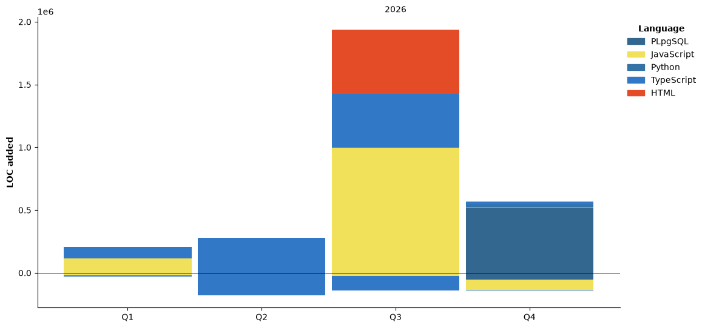

## Hi there 👋 I'm Victor Hugo!

🌐 NOC by day, builder by night. Networking, Python, TypeScript, Supabase — always shipping something small.

## Stack


## ⏱️ Coding Activity
<!--START_SECTION:waka-->


**🐱 My GitHub Data** 

> 📦 70.4 kB Used in GitHub's Storage 
 > 
> 🏆 1,049 Contributions in the Year 2026
 > 
> 💼 Opted to Hire
 > 
> 📜 3 Public Repositories 
 > 
> 🔑 11 Private Repositories 
 > 
**I'm an Early 🐤** 

```text
🌞 Morning                455 commits         ██████░░░░░░░░░░░░░░░░░░░   25.50 % 
🌆 Daytime                626 commits         █████████░░░░░░░░░░░░░░░░   35.09 % 
🌃 Evening                593 commits         ████████░░░░░░░░░░░░░░░░░   33.24 % 
🌙 Night                  110 commits         ██░░░░░░░░░░░░░░░░░░░░░░░   06.17 % 
```
📅 **I'm Most Productive on Monday** 

```text
Monday                   347 commits         █████░░░░░░░░░░░░░░░░░░░░   19.45 % 
Tuesday                  298 commits         ████░░░░░░░░░░░░░░░░░░░░░   16.70 % 
Wednesday                347 commits         █████░░░░░░░░░░░░░░░░░░░░   19.45 % 
Thursday                 268 commits         ████░░░░░░░░░░░░░░░░░░░░░   15.02 % 
Friday                   200 commits         ███░░░░░░░░░░░░░░░░░░░░░░   11.21 % 
Saturday                 130 commits         ██░░░░░░░░░░░░░░░░░░░░░░░   07.29 % 
Sunday                   194 commits         ███░░░░░░░░░░░░░░░░░░░░░░   10.87 % 
```


📊 **This Week I Spent My Time On** 

```text
🕑︎ Time Zone: America/Sao_Paulo

💬 Programming Languages: 
Markdown                 9 hrs 2 mins        █████████████░░░░░░░░░░░░   52.98 % 
Other                    2 hrs 38 mins       ████░░░░░░░░░░░░░░░░░░░░░   15.44 % 
Text                     2 hrs 16 mins       ███░░░░░░░░░░░░░░░░░░░░░░   13.31 % 
JavaScript               1 hr 1 min          ██░░░░░░░░░░░░░░░░░░░░░░░   06.03 % 
HTML                     39 mins             █░░░░░░░░░░░░░░░░░░░░░░░░   03.90 % 

🔥 Editors: 
Claude Code              14 hrs 57 mins      ██████████████████████░░░   87.57 % 
Antigravity CLI          2 hrs 7 mins        ███░░░░░░░░░░░░░░░░░░░░░░   12.43 % 

🐱‍💻 Projects: 
root-kratos              11 hrs 14 mins      ████████████████░░░░░░░░░   65.86 % 
fiber-alert              2 hrs 14 mins       ███░░░░░░░░░░░░░░░░░░░░░░   13.17 % 
NORTPRIMECRED            2 hrs               ███░░░░░░░░░░░░░░░░░░░░░░   11.77 % 
book-to-skill            50 mins             █░░░░░░░░░░░░░░░░░░░░░░░░   04.94 % 
olt-check                31 mins             █░░░░░░░░░░░░░░░░░░░░░░░░   03.06 % 

💻 Operating System: 
Windows                  17 hrs 4 mins       █████████████████████████   100.00 % 
```

🤖 **AI Coding This Week** 

```text
⏱ AI Coding Time: 17 hrs 4 mins (100.0%)

✍️ 6,337 lines written by AI, 0 lines written by hand (100.0% AI-written)

🔤 6,881,769 Input Tokens, 924,781 Output Tokens

💵 $68.97 Estimated AI Cost This Week

🧠 61 AI Sessions, 408 AI Prompts

Opus                     6,357 lines         █████████████████████████   100.00 % 
Gemini                   0 lines             ░░░░░░░░░░░░░░░░░░░░░░░░░   00.00 % 
Haiku                    0 lines             ░░░░░░░░░░░░░░░░░░░░░░░░░   00.00 % 

🔎 AI Coding Insights:
🤖 AI-Driven — 100.0% of written lines came from AI
📄 Detailed Prompter — average 1,392 characters per prompt
🔁 Iterative Prompter — average 7 prompts per session
🚀 High AI Trust — 0.0% of changed lines were hand-edited
```

**I Mostly Code in TypeScript** 

```text
TypeScript               8 repos             ██████████████░░░░░░░░░░░   57.14 % 
JavaScript               2 repos             ████░░░░░░░░░░░░░░░░░░░░░   14.29 % 
HTML                     2 repos             ████░░░░░░░░░░░░░░░░░░░░░   14.29 % 
PLpgSQL                  1 repo              ██░░░░░░░░░░░░░░░░░░░░░░░   07.14 % 
Python                   1 repo              ██░░░░░░░░░░░░░░░░░░░░░░░   07.14 % 
```


**Timeline**




 Last Updated on 24/11/2026 08:37:06 UTC
<!--END_SECTION:waka-->

## 🚀 Projects
- **[Fiber Alert](https://fiber-alert.vercel.app/)** — real-time NOC dashboard for fiber-optic incidents, geospatial map, RLS + JWT auth
- **[Fábrica Ágil](https://agile-fabric.vercel.app/)** — multi-tenant ERP/MES, NF-e integration, RBAC, audit trail
- **Escala SAC/NOC** — scheduling engine for support/NOC teams with conflict detection
- **Wow Private** — full game server infra from scratch (Proxmox, MySQL, secure Edge Function proxy)

## 📫 Connect
[LinkedIn](https://www.linkedin.com/in/hugomarinho93/)
<!--
**opropriokratos/opropriokratos** is a ✨ _special_ ✨ repository because its `README.md` (this file) appears on your GitHub profile.

Here are some ideas to get you started:

- 🔭 I’m currently working on ...
- 🌱 I’m currently learning ...
- 👯 I’m looking to collaborate on ...
- 🤔 I’m looking for help with ...
- 💬 Ask me about ...
- 📫 How to reach me: ...
- 😄 Pronouns: ...
- ⚡ Fun fact: ...
-->
